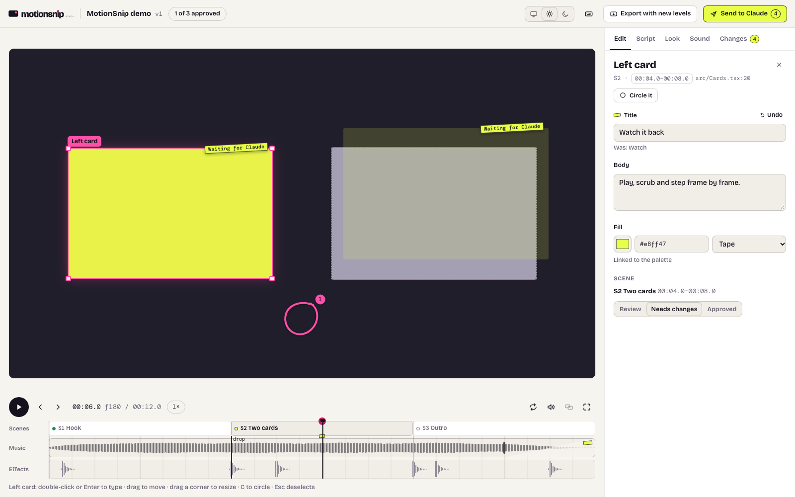

<h1>
  <picture>
    <source media="(prefers-color-scheme: dark)" srcset="docs/brand/logo-dark.svg">
    
  </picture>
</h1>

**Review the videos Claude builds in code, fix them in place, and send one prompt back.**

[motionsnip.com](https://motionsnip.com) · [Live demo](https://motionsnip.com/demo/)

<picture>
  <source media="(prefers-color-scheme: dark)" srcset="docs/screenshot-dark.png">
  
</picture>

## How it works

1. You ask Claude for a motion graphic: a launch video, an explainer, a product promo.
2. Claude builds it in code (for example with Remotion), renders it, and describes it in `reel.json`.
3. Claude checks its own render first and marks anything it isn't sure about. Then it opens the player. You watch it on your own machine.
4. You fix words in place, swap the music, set levels, move things, and circle problems on the frame.
5. You mark each scene **Approved** or **Needs changes**. Claude leaves approved scenes alone.
6. You click **Send to Claude**. The player writes your changes to a file and hands them straight to Claude in the chat you're working in.
7. Claude applies the changes, re-renders and bumps the version. (If Claude isn't listening, say in a tool that can't run background commands, the player copies one line for you to paste instead.)
8. The player reloads by itself and helps you check each change. Repeat until every scene is approved.
9. You click **Export** to get the final mp4, with the music you picked mixed in.

Everything runs locally. The player is a small Node server bound to `127.0.0.1` and a web page. No accounts, no cloud, no build step, no dependencies.

## Install

You need [Claude Code](https://claude.com/claude-code) and Node 18 or newer. Export also needs [ffmpeg](https://ffmpeg.org).

```bash
git clone https://github.com/jishanpathan7/motionsnip-studio.git ~/.claude/skills/motionsnip-studio
```

Or, with the GitHub CLI: `gh repo clone jishanpathan7/motionsnip-studio ~/.claude/skills/motionsnip-studio`.

That's it. Restart Claude Code and it finds the skill.

## Try it in a minute

Open the player on the demo project that ships with it:

```bash
node ~/.claude/skills/motionsnip-studio/player/server.mjs ~/.claude/skills/motionsnip-studio/examples/demo
```

Your browser opens the player. Press Space to play, pause on the opening headline and click it to change its words, right-click the frame to pin a note, then open the **Changes** tab to see everything Send to Claude will pass on.

## Update or remove

```bash
git -C ~/.claude/skills/motionsnip-studio pull    # update
rm -rf ~/.claude/skills/motionsnip-studio         # remove
```

Your projects keep their own `reel.json`, `.motionsnip/` history and `exports/`, so removing the skill doesn't touch them.

## Use

Ask Claude for a video:

> Make a 30 second launch video for Acme. Upbeat, our brand colours, a few big headlines.

Claude builds it and opens the player. When you're done reviewing, click **Send to Claude**. Claude listens to the player while you review, so your changes land in the same chat and it starts on them right away. If it isn't listening, the player copies this line for you to paste instead:

> Apply the MotionSnip Studio feedback in /path/to/project/.motionsnip/feedback-v1.md

You can also start the player yourself on any project folder with a `reel.json`:

```bash
node ~/.claude/skills/motionsnip-studio/player/server.mjs path/to/project
```

Options: `--port 4321` (moves to the next free port if busy), `--no-open`, `--ffmpeg /path/to/ffmpeg`, `--addons <dir>` (add-ons from that folder instead of `~/.motionsnip/addons`), `--no-addons`, `--safe` (never run code from the project folder: no `export.cmd`, no `live.js`).

## Edit any video

The player also opens a plain video file, with no `reel.json`: a screen recording, a phone clip, a render from any tool.

```bash
node ~/.claude/skills/motionsnip-studio/player/server.mjs path/to/clip.mp4
```

Pointing it at a folder without a `reel.json` opens the newest video in it. In the **Edit** tab you can:

- **Trim** the start and end (`I` and `O` at the playhead) and **cut parts out** (`X` at the start of a part, `X` again at its end). The preview plays the edited cut.
- Put **text**, a **logo** (drop a png, jpg or webp on the page) or a **blur box** on the frame, each for as long as you choose.
- Set the **colour**: brightness, contrast, saturation, warmth. Hold `\` to compare with the original.

**Export with your edits** re-encodes the video with all of it, plus any music you picked on the **Sound** tab. The original file stays as it is. Notes you pin on the frame still go to Claude with **Send to Claude**. Exporting edits needs an ffmpeg build with the `overlay`, `gblur`, `colorchannelmixer` and `lutrgb` filters; the standard builds have them.

## Cutdowns

One master, every shape. **+ Cutdown** above the frame makes a **9:16**, **1:1** (or **16:9** from a vertical master) or a **6-second bumper** with ffmpeg, into `outputs/`. Each gets its own tab with its own notes, and the music is mixed in.

- **Reframe** a 9:16 or 1:1: the master shows a window the shape of the cutdown. Drag it to set the crop at the playhead; between keys it glides, at a cut add a key each side. **Auto** guesses from the elements in each scene; **Whole frame** fits it on a blurred fill instead. **Render** makes it again.
- **Safe areas**: title/action safe, and the parts of the screen Reels, TikTok and Shorts cover with their own buttons and captions (approximate).
- Notes on a cutdown go to Claude under their own heading, on that version's frame and clock. If the master changes, the cutdown's tab shows a dot until you re-render it.
- Claude can lay a code-built video out again for 9:16 and list it in `reel.json` `outputs`; it shows up as a tab the same way.

## Animated scenes

Describe a scene in words and Claude makes it: hand-drawn people and robots, props, speech bubbles, charts that draw themselves, camera moves and shot transitions. Claude writes `scene.json` (data, not code) and MotionSnip Studio draws it live, so it plays and scrubs at once.

- Everything is reviewable like any project: shots are scenes in the timeline, each person, prop and line is an element. Click a line to retype it, recolour a shirt, drag someone to move them in that shot; it shows straight away.
- **Send to Claude** names exact places in `scene.json` (`shots[0].beats[1].text`), so the next version changes only what you asked.
- MotionSnip Studio checks the scene itself and rings what a viewer would trip on: lines too fast to read, a line cut off by the next shot, something off the frame.
- Three looks to start (`ink`, `marker`, `flat`) with your own palette. Try `examples/scene-demo`:

```bash
node player/server.mjs examples/scene-demo
```

**Export** draws every frame of a scene to MP4, HEVC, ProRes, WebM or GIF. Changed words or colours can go straight into `scene.json` with **Apply** in Changes, as the next version, without Claude.

## Timeline projects

For a whole video (footage, illustrated scenes, titles, music and captions together), Claude writes `timeline.json` and you get a real editor beside the review tools:

- **Tracks and clips.** Video, scene, graphics, audio and captions tracks with mute, solo, hide and lock. Drag a clip to move it (onto another track too), drag an edge to trim, Alt-drag to slip, `S` to split at the playhead, `Delete` (Shift closes the gap), zoom with ⌘-scroll. Clips snap to the playhead, other clips and markers.
- **Make things.** Add text (with animation presets like pop, type-on and word-stagger), shapes, captions and scene clips, or drop videos, pictures and sounds from Finder onto a track.
- **Animate.** In the Edit tab: transitions in and out (fade, wipe, slide, zoom), keyframes for position, scale, rotation and opacity at the playhead, volume and fades, colour look, text style.
- **Undo and redo** everything. Every edit is saved into `timeline.json` at once, so Claude works on exactly what you see; if Claude changes the file while you watch, the editor picks it up.
- **Start from a plain video.** Open any video, trim and cut it, put words, a logo or a blur on it, then **Open in timeline** (in the Edit tab): your edits become clips in `timeline.json` next to the video, and the video file stays as it is.
- **Ask for something new** in the Changes tab ("a 20 s teaser: a stuck developer, then our app saves the day, with captions"): it goes to Claude with Send.
- **Export** with sound to MP4, HEVC, ProRes, WebM or GIF at 720p to 4K and 24 to 60 fps, captions drawn in or saved as `.srt` and `.vtt`. Make 9:16, 1:1 and bumper versions from it with Cutdown. When it can, ffmpeg draws the footage and the page draws only what goes on top, which is about twice as fast; a timeline with something it can't split that way (a wipe on footage, a graphic under footage, a moving blur box) is drawn frame by frame as before.

```bash
node player/server.mjs examples/timeline-demo
```

## Player controls

| Key or action | What it does |
|---|---|
| Space | Play or pause |
| ← → or `,` `.` | Step one frame |
| Shift + ← → | Jump one second |
| Home / End | Go to the start or end |
| `[` `]` | Previous or next scene |
| `L` | Loop the current scene |
| `<` `>` | Slower or faster (0.25× to 2×) |
| `F` or double-click an empty spot | Fullscreen |
| `M` | Mute |
| `A` | Approve the current scene |
| Hold `V` | Show the previous version at the same frame |
| `?` | Show all shortcuts |
| Esc | Cancel, deselect or leave fullscreen |
| Click an element | Select it and open its settings |
| Double-click an element, or Enter | Edit its text in place |
| Drag an element or its corner | Move or resize it |
| Right-click, or `C` | Pin a note at that spot and time |
| Drag the music lane | Change when the music starts |
| Drag the end of the music lane | Set the fade-out |
| Drop an audio file on the page | Use it as the music |
| `I` `O` (plain video) | Trim the start or end at the playhead |
| `X` … `X` (plain video) | Cut out the part between the two presses |
| `T` (plain video) | Add text on the frame |
| Hold `\` (plain video) | See the original, without your edits |

Side panel tabs: **Edit** (the selected element), **Script** (every line of text in time order), **Look** (brand colours, fonts, logo), **Sound** (music, start, fade, levels) and **Changes** (everything you changed, with undo, and the Send button).

Deep links: `#t=12.5&el=headline`, `#tab=sound`, `?theme=dark`.

## Claude's self-review

Before you see v1, Claude grabs frames from its own render and looks for small text, things outside the safe area, low contrast, typos, overflow and flash frames on cuts. Whatever it couldn't fix, or isn't sure about, shows up on the frame as a dashed blue ring labelled **C1**, **C2**… and in **Changes** under **Claude spotted**.

Click a ring to read what Claude saw and what it suggests. **Add as my note** turns it into your own note, so it goes back with your feedback. **Dismiss** tells Claude you're happy with it, and it won't flag it again. The demo reel ships with three real findings to try.

## What Claude receives

When you send, the player writes `.motionsnip/feedback-v<N>.md` in the project and copies one line to your clipboard. The file looks like this:

```
MotionSnip Studio feedback for "Acme launch" v3
Project: /path/to/acme · 1920x1080 · 30 fps · 32s

## Exact changes
- [00:01.2 · S1 · Headline] Text (src/Hook.tsx:12): "Meet Acme" -> "Say hi to Acme"
- [00:06.0 · S2 · Card] Size and position (src/Cards.tsx:20): [10, 30, 35, 40] -> [8, 28, 39, 44] (scale 1.12)

## Sound settings
- Audio · Music track: "track.mp3" -> "upbeat.mp3" (uploaded in MotionSnip Studio, already in assets/)
- Audio · Music start offset (s): 0 -> 2
- Audio · Music volume (0-1): 1 -> 0.6
The video carries sound effects only; music is a separate file.

## Comments on the frame
1. [00:23.9 · S4 Outro · x 23.9% y 81.8% · on Logo (src/Outro.tsx:9)] Logo feels too small here
2. [00:01.5 · S1 Hook · x 90.0% y 11.5% · on Cue dot] Cue dot sits outside the title-safe area. (from your self-review, v3-1; the reviewer agrees)

## Dismissed from your self-review
The reviewer looked at these and is happy as it is. Leave them, and don't flag them again.
- v3-2 [00:08.0] Scene 2 cards flash on the light background

## Scenes
S1 Hook (00:00.0-00:04.5): approved
S2 Cards (00:04.5-00:12.0): needs changes

Next version: set "version" to 4 in reel.json.
```

Edits are exact values. Notes are requests, tied to a time and a spot on the frame, so Claude can grab that frame and look.

## reel.json

`reel.json` describes the video for the player: its file, size and length, the scenes, and the elements in each scene with their position on the frame and their editable values. Claude writes it. The full schema is in [`SKILL.md`](SKILL.md) and [`docs/SPEC.md`](docs/SPEC.md). A working example is in [`examples/demo/reel.json`](examples/demo/reel.json).

The key ideas:

- Each element has a `box` (x, y, w, h in % of the frame), so you can click it.
- Each element has `props` with types (`text`, `color`, `number`, `list`, `motion`…), so the player knows how to edit them.
- `version` goes up on every render, and the player reloads when it changes.
- Music is its own file (`audio.music`), and the video carries only sound effects. So you can swap the track and set levels without a re-render.

## Security

- The server listens on `127.0.0.1` only.
- It rejects requests whose `Host` header isn't `localhost:<port>` or `127.0.0.1:<port>`. This blocks DNS rebinding.
- Every POST must come from the player page itself (checked with the `Origin` header).
- Project files are served only from inside the project folder. Hidden files such as `.env` are never served.
- Uploads accept only mp3, wav and m4a, up to 100 MB. The first bytes must match the file type. Names are cleaned and files are never overwritten.
- "Show in Finder" works only for files inside the project.
- If `reel.json` has an `export.cmd`, the render export runs that command on your machine, like an npm script. A `live` script (`live.js`) runs in the player page. Only open projects you trust, or start the server with `--safe`, which runs neither: the player shows the rendered video and says what was left out.
- Add-ons in `~/.motionsnip/addons` run with the same rights as MotionSnip itself, like any program you install. Only install add-ons you trust. An add-on that needs a licence you don't hold stays locked: its code isn't loaded.
- The Pro add-on is downloaded only after its Ed25519 signature and SHA-256 hash check out, and it is unpacked with no links and no paths outside its folder.

## Tests

```bash
node player/server.mjs --selftest
```

It checks byte ranges, upload name cleaning, file type sniffing, the host and origin checks, the ffmpeg mix arguments, add-on loading and the Pro licence and package checks (against a fake licence server), and runs a real upload against a temporary project. It prints `selftest ok`.

To measure how much CPU an export costs on your machine (needs Chrome or Chromium, and ffmpeg):

```bash
node player/bench/render.mjs --size 1080 --runs 2
```

## Troubleshooting

**Claude doesn't open the player.**
Restart Claude Code after installing, so it loads the skill. Check that `~/.claude/skills/motionsnip-studio/SKILL.md` exists. You can also ask for it by name: "Use MotionSnip Studio to review this video."

**The video doesn't load.**
`src` in `reel.json` must point at the rendered file, relative to the project folder. Ask Claude to re-render, or fix the path.

**The player didn't reload after a new render.**
It reloads when `version` in `reel.json` goes up. Ask Claude to bump it, or reload the page.

**Port 4321 is busy.**
The server moves to the next free port and prints the address. Use `--port` to pick one.

## FAQ

**Does anything leave my machine?**
No. The player's fonts come with it, and your video, music, edits and notes stay on your machine. The only exception is MotionSnip Pro, and only if you use it: activating a licence, refreshing it, and downloading the Pro add-on talk to `licence.motionsnip.com`, sending the licence key (or the licence) and a random ID for this computer. A licence that ends within 7 days is refreshed when the player starts; offline, Pro keeps working until the licence ends.

**What is MotionSnip Pro?**
A paid add-on with extra timeline clips (the first pack is a UI-demo kit: app and browser windows, a terminal, a code editor, a cursor, typing and notifications). Everything in this repository stays free and MIT. Activate a key with the **Pro** button in the header, or from a terminal:

```bash
node player/server.mjs --activate <licence-key>
```

That saves `~/.motionsnip/licence.json` and installs the add-on in `~/.motionsnip/addons/pro`. `--licence` shows its state and `--deactivate` frees the key for another computer. If the subscription ends, the Pro versions released while it ran keep working.

**Where are my edits saved?**
In your browser's storage and in `.motionsnip/state.json` in the project folder. Closing the tab doesn't lose them. Each round you send is kept as `.motionsnip/feedback-v<N>.md`. Exports go to `exports/` and are never overwritten.

**Do I need Remotion?**
No. Any tool that renders an mp4, webm or mov works. Claude only needs to write `reel.json` next to it. Remotion is a good default because everything is code.

**What about Remotion's licence?**
Remotion is free for individuals and for companies of up to 3 people. Bigger companies need a company licence from [remotion.dev](https://www.remotion.dev/license). MotionSnip Studio doesn't include Remotion.

**Why is the music a separate file?**
So you can try another track, move its start or change the levels without waiting for a render. Export mixes it into the final mp4 with ffmpeg.

**Export says ffmpeg isn't found.**
Install it (`brew install ffmpeg` on macOS), or start the server with `--ffmpeg /path/to/ffmpeg`. A Remotion project's bundled ffmpeg is also found automatically.

## Files

```
SKILL.md              the Claude Code skill
player/server.mjs     the local server (Node 18+, no dependencies)
player/lib/           server modules: HTTP, files, media, the project store, jobs, cutdowns, frame and composed export, add-ons, the Pro licence
player/bench/         the render benchmark (CPU per minute of exported video)
player/index.html     the player page
player/app/           the player's scripts and styles
player/app/scene/     the scene compiler and hand-drawn renderer (no dependencies)
player/app/comp/      the timeline model, edit operations, compositor and frame export
player/app/fonts/     Bricolage Grotesque, DM Mono and Patrick Hand (SIL Open Font License)
player/app/tracks.js  the multi-track timeline editor
docs/SPEC.md          the full product spec
docs/brand/           logo, favicons and the brand guide
examples/demo/        a small example project (synthetic video and music)
examples/scene-demo/  a scene project: scene.json drawn live
examples/timeline-demo/ a timeline project: footage, a scene, titles, music and captions
examples/addons/hello/ an example add-on: one server route and one header button
```

## Licence

[MIT](LICENSE). Copyright (c) 2026 Jishan Pathan.

The fonts in `player/app/fonts/` are under the SIL Open Font License 1.1; each family's licence is beside it.
